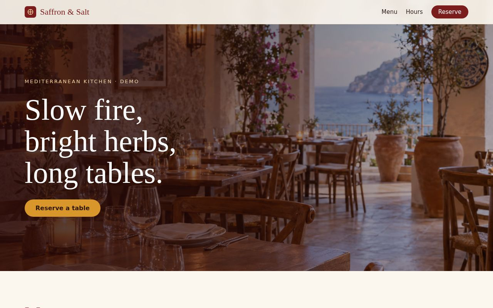
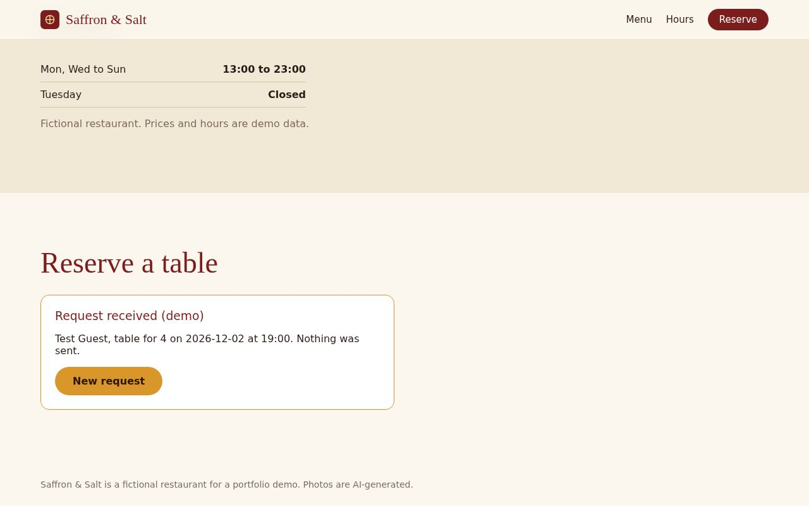
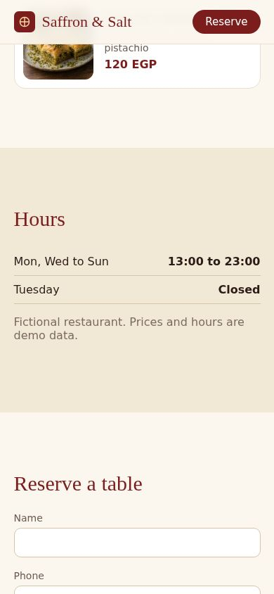

# Saffron & Salt Restaurant Site (React + Vite)

A restaurant website demo with online reservations. The restaurant is fictional. Photos are AI-generated. No bookings are sent anywhere.

## Features
- Menu with category filters
- Reservation form with validation: party size 1 to 12, no past dates, closed on Tuesdays
- Confirmation screen with the booking details
- Responsive layout for desktop and mobile

## Run
```bash
npm install
npm run dev
npm run build
```

## Demo video
[docs/demo.mp4](docs/demo.mp4)

## Preview




## Tests
Headless Chrome checks: menu filters, form validation, Tuesday closed, past date rejected, party size limits, confirmation, mobile layout.
